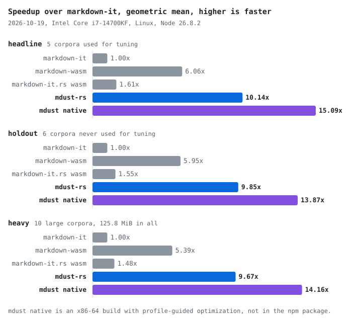

<p align="center"></p>

<h1 align="center">mdust</h1>

<p align="center">The HTML markdown-it writes, byte for byte, about 10 times faster. Rust compiled to WebAssembly.</p>

<p align="center"><a href="https://www.npmjs.com/package/mdust-rs"></a></p>

mdust is for anyone who renders Markdown in Node or the browser and already uses markdown-it, or needs output that matches it. If you call markdown-it with its default preset and `{ html: true }`, swap the call and keep every byte of your HTML.

## Install and render

```sh
npm install mdust-rs
```

In Node, the module loads synchronously on import, so `render` works on the first line.

```js
import { render } from 'mdust-rs';

render('# hi'); // '<h1>hi</h1>\n'
```

CommonJS works too, as `const { render } = require('mdust-rs')`.

In the browser, call `await init()` once before the first `render`. It fetches the wasm file from next to the loader.

```html
<script type="module">
	import { init, render } from './node_modules/mdust-rs/mdust_wasm.web.mjs';

	await init();
	document.body.innerHTML = render('# hi');
</script>
```

Vite and webpack 5 copy the wasm file into your build. The [package README](npm/README.md#use-it-in-the-browser) covers other bundlers and every input `init` accepts.

## Speed

<picture>
	<source media="(prefers-color-scheme: dark)" srcset="docs/bench-dark.svg">
	
</picture>

Each cell is a geometric mean of markdown-it's time divided by the renderer's time. Higher is faster.

| renderer | headline | holdout | heavy |
|---|---:|---:|---:|
| markdown-it 15.0.3 | 1.00x | 1.00x | 1.00x |
| markdown-wasm 1.2.0 | 6.06x | 5.95x | 5.39x |
| markdown-it.rs 0.6.1, wasm | 1.61x | 1.55x | 1.48x |
| **mdust-rs, this package** | **10.14x** | **9.85x** | **9.67x** |
| mdust native, x86-64 | 15.09x | 13.87x | 14.16x |

- **Headline** is the 5 corpora used to judge and tune speed, including the Rust book and the Node API docs.
- **Holdout** is 6 corpora that were measured but never used for tuning. mdust-rs keeps 9.85x there, so the speed is not fitted to the headline set.
- **Heavy** is 10 large corpora, 125.8 MiB of Markdown in all, such as MDN, the Kubernetes docs and the freeCodeCamp curriculum.

mdust native is the same crate built for x86-64 with profile-guided optimization. It is not in the npm package.

Measured on 2026-10-19 on an Intel Core i7-14700KF, Linux, Node 26.8.2, with `RUNS=7 CPU=10 node run.mjs` in `bench/`, and with `CORPORA` set to the heavy corpora for that set. Each per-corpus time is the median of 7 runs pinned to one core. Per-corpus results for all 21 corpora are in the [package README](npm/README.md#benchmarks). `node bench/chart.mjs` redraws the chart from `bench/results.json`.

## Same output as markdown-it

The target is the string that `new MarkdownIt('default', { html: true }).render(src)` returns with markdown-it 15.0.3. On 2026-10-19, mdust matched it on 100% of 40,919 documents and fixture cases, compared with `===`. They include the 652 CommonMark spec examples, the markdown-it fixture files and every document of 23 corpora. On the 61 spec examples where markdown-it departs from the spec, mdust follows markdown-it. If you move from that markdown-it configuration to mdust, your HTML does not change.

## What you get

- No runtime dependencies in the npm package.
- One wasm file of 179,356 bytes and loaders of 77 to 1,675 bytes, with TypeScript types.
- A synchronous `render` in Node, from both `import` and `require`.
- The same `render` in the browser after one `await init()`.
- One function to learn, `render(src)`, which takes a string and returns a string.
- A native Node add-on in `crates/mdust-napi` that builds from this repository but is not published.

## What you give up

- No options and no plugins. The output always matches markdown-it's `default` preset with `{ html: true }`. If you need other options, use markdown-it.
- Raw HTML in the input passes through unchanged. Sanitize the output before you insert untrusted Markdown into a page.
- A panic aborts the render, and `render` throws a `WebAssembly.RuntimeError`.
- No streaming. Each call takes the whole document, and wasm memory never shrinks after a large one.

## Under the hood

- The parser is a `no_std` Rust crate with one dependency, `hashbrown`.
- SIMD scanners read 16 bytes per step to find line ends, the end of each run of text, and the bytes HTML escaping must replace.
- Text that needs no unescaping is never copied, and stays a slice of your input until the renderer writes it out.
- In wasm, each render resets a bump allocator to the same base address instead of freeing objects one at a time.
- The native build picks SSE2, SSSE3 or AVX2 at run time.

The [package README](npm/README.md#what-is-inside) has the design notes.

<details>
<summary>Repository layout and build</summary>

**Layout.**

- `crates/mdust` is the parser and renderer, a `no_std` Rust library.
- `crates/mdust-wasm` exports `mdust::render` to WebAssembly through two buffers that the JS loaders read and write.
- `npm/` is the `mdust-rs` npm package. npm refused the bare name mdust as too close to an existing package. It holds the Node loader `mdust_wasm.js`, its ES module wrapper `mdust_wasm.mjs`, the browser loader `mdust_wasm.web.mjs`, and the types in `index.d.ts`.
- `bench/` holds the parity checks and the benchmark harness, and compares every output against markdown-it.
- `tools/gen_tables.cjs` generates `crates/mdust/src/tables.rs`, the entity and Unicode punctuation tables.
- `crates/mdust-napi` and `native/` build a native Node add-on, marked private in `native/package.json`.
- `logo/` holds three logo concepts as SVG.
- `docs/` holds the benchmark chart that `bench/chart.mjs` writes.

**Build.** You need a Rust toolchain with the `wasm32-unknown-unknown` target, and Node with npm.

1. To build the wasm file into `npm/`, run `npm --prefix npm run build` from the repository root.
2. To make the npm tarball, run `npm pack` in `npm/`. It writes `npm/mdust-rs-0.1.1.tgz`.

The build output, `npm/mdust_wasm_bg.wasm` and the tarball, is not committed.

**Check parity and benchmark.** The benchmark harness reads its corpora from `bench/corpus`, which is not committed.

1. In `bench/`, run `npm install` and `./fetch-corpus.sh` to get markdown-it and the corpora.
2. Run `npm run build:mdust`. It builds `npm/` and copies the wasm file and the loaders into `crates/mdust-wasm/pkg`, which the harness loads.
3. To check parity against markdown-it on every fixture suite and corpus, run `node conformance.mjs --impl mdust`.
4. To time every implementation, run `node run.mjs`. `CORPORA=rust-book RUNS=1` limits a run to one corpus and one sample. `CPU=<n>` picks the core that `taskset` pins each run to.
5. To check the browser loader in headless Chromium, run `node browser.mjs`.

`run.mjs` also times markdown-wasm, the markdown-it.rs crate, and a native build of mdust. To build the markdown-it.rs and native binaries, run `npm run build` in `bench/`.

</details>

## License

MIT
